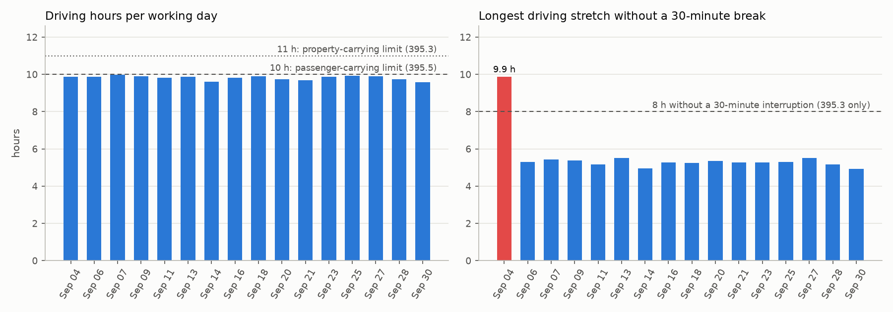
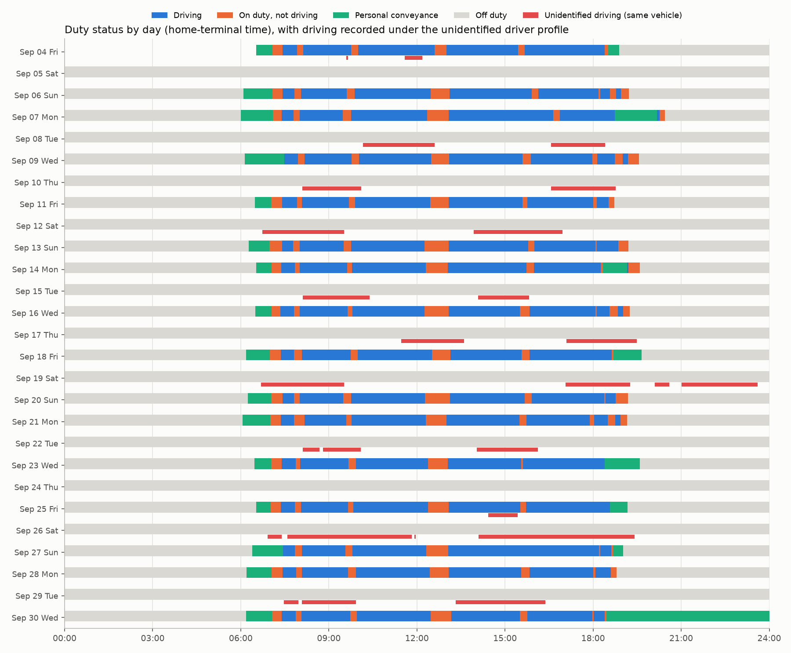

# fmcsa-eld-logbook-toolkit

Parse, verify and reconcile FMCSA ELD output files (49 CFR Part 395 Appendix A, section 4.8.2.1)
and run the hours-of-service rules on the duty-status record they carry. Built on one driver's real
month of logs from a small carrier, de-identified, together with the carrier portal's event export
for the same month. The device maker's certification-test files were used privately to exercise the
parser and are not published.

```
pip install -e ".[dev]"
eldfile verify    data/input/driver_output_file.csv
eldfile validate  data/input/driver_output_file.csv
eldfile reconcile data/input/driver_output_file.csv data/input/driver_events_export.csv
eldfile hos       data/input/driver_output_file.csv --rules passenger
eldfile report    data/input/driver_output_file.csv --export data/input/driver_events_export.csv --out reports
```

## What the month shows

Full report with tables: [reports/report.md](reports/report.md).

1. **Every data check in the file verifies** with the Appendix A algorithms implemented from the
   regulation text: 800/800 line checks, the file check and 424/424 driver event checks. The 83
   event checks of the unidentified-driver profile, whose username is not in the file, are consistent
   with a single username. This is the first independent confirmation that the device's check-value
   implementation matches the specification on a production file.
2. **The output file and the portal's event export agree record for record**: 790 sequence ids
   matched, none missing on either side, 0 differences in kind, status, timestamp, vehicle or the
   odometer and engine-hour totals (267 records carry them).
3. **The driver worked 16 days**, driving 9.59 to 9.99 h per day and 11.2 to 12.2 h on duty, every
   working day starting and ending with a personal-conveyance period. No sleeper-berth time.
4. **The rule set matters more than the logs.** Under the property-carrying rules (395.3) the month
   holds one violation (Sep 4: driving continued 1.88 h past 8 cumulative hours without a 30-minute
   interruption; the lunch stop that day was 25 minutes). Under the passenger-carrying rules (395.5)
   it holds none, but the longest day reaches 9.987 h of driving against the 10-hour limit, a margin
   of 0.8 minutes: the schedule leaves no slack.
5. **The same vehicle was driven on 9 days with nobody logged in**: 27 unidentified driving records,
   52 h and 1,424 miles, all on days this driver was off. Three more unidentified driving records
   start in the same second as a logout of this driver and end at the next login (1.67 h of the
   driver's own driving parked in the unidentified profile). The device raised the
   unidentified-driving diagnostic on Sep 10 and it was never cleared in the period. Unassigned
   driving must be reviewed and assigned or annotated by the carrier (395.32).
6. **Record keeping**: 16 certification records, one per working day. The last record of the period
   is a personal-conveyance indication (Sep 30 18:27) with no off-duty record after it.





### What the certification-test files added (not published)

Thirty output files from the device maker's own testing (July to September), kept private, were
run through the same parser and validator:

* 29 parse; all line checks verify in 28 and the file check in all 29.
* In one file, 24 lines fail their line check and every one of them carries the same VIN: the VIN
  was edited after the check values were computed. The line check does its job.
* Event checks are computed when a record is created, with the vehicle's power-unit number as
  known then. In seven files, between 6 and 100 percent of the event checks verify only when the
  power-unit element is empty, or with neither value: the vehicle's unit number was blank or
  different at record time. A validator has to report such mismatches as a provenance change, not
  as corruption, which is how `eldfile validate` labels them.
* A raw file with 84 duplicate sequence ids and 13 failing event checks exists next to a hand
  "modified" copy with neither: the duplicates were removed by hand before submission.

## Data

| file | content |
|---|---|
| `data/input/driver_output_file.csv` | the ELD output file (CR-delimited, 800 data lines, Sep 4 to Sep 30), every identifier replaced by a keyed pseudonym, coordinates on a 0.05-degree grid, every check value recomputed so the file still verifies |
| `data/input/driver_events_export.csv` | the same month from the carrier portal's event export (790 rows), location text reduced to the state |
| `data/input/SOURCE.md` | the pseudonym table and the rewrite rules |
| `scripts/prepare_inputs.py` | the publishing script; runs privately with the raw files and the de-identification key of the foundation project, so the carrier and the vehicle join to its `dim_org` and `dim_vehicle` |

The de-identification keeps the file verifiable: after every rewrite the line, event and file
check values are recomputed with `eldfile.checks`, which is why the published file is a working
test vector for any implementation of the Appendix A algorithms.

## Modules

| module | what it does |
|---|---|
| `eldfile.checks` | the data check values: character mapping, line check, event check (ten elements, XOR C3), file check (XOR 969C) |
| `eldfile.parse` | output file reader (CR, LF or CRLF), eleven sections to frames, header fields by name, issues for structural problems |
| `eldfile.validate` | data checks including the single-username test for the unidentified profile, header and record domains, cross references, sequence uniqueness and ordering |
| `eldfile.reconcile` | file versus portal export per sequence id: presence, kind, record status, timestamp, vehicle, odometer and engine-hour totals |
| `eldfile.hos` | duty timeline from the active records (personal conveyance off duty, yard moves on duty), daily summary, the 395.3 and 395.5 rule sets, the unidentified driver profile |
| `eldfile.report` | figures, tables and the Markdown report |
| `eldfile.cli` | the `eldfile` command |

Rules implemented: driving limit (11 h / 10 h), the 14-hour window (property) or 15 cumulative
on-duty hours (passenger), the 30-minute break rule (property), the 60/70-hour rule with the
34-hour restart, one row per rule and duty period. Not implemented: sleeper-berth splits, the
short-haul and adverse-conditions exceptions; the sample month records no sleeper-berth time, so
they would not change its result.

## Tests

`pytest` covers the check algorithms against the worked examples of the ELD ICD handbook and its
sample file (all 17 line checks), the parser, the published inputs (verify completely, pseudonymized,
grid coordinates, sequence space equal to the export), validation on tampered copies, reconciliation
with injected differences, the HOS rules on hand-built timelines with worked-out expectations, the
published month, and every command end to end. CI runs the suite on Python 3.10 and 3.12, verifies
the published file and checks that a fresh report equals the committed one.

## Limitations

One driver, one vehicle, one month, one device model. The passenger-versus-property question is
decided by the carrier's operation, not by the file; both rule sets are reported. Times are the
home-terminal local times the file carries. The checks were written from the regulation text and the
handbook, not from any device maker's source.

## License

MIT.
