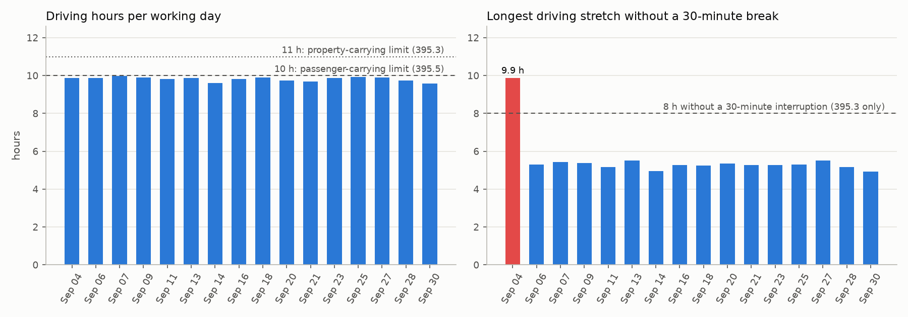
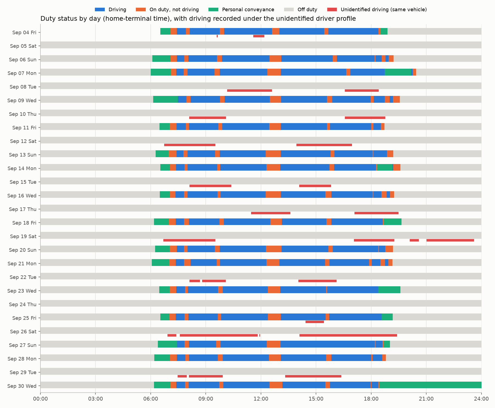

# ELD output file: verification, reconciliation and hours-of-service findings

Input: `DEID` output file for driver `drv_ce296a55a3`, carrier `ORG-d833e2b8fc`, power unit `PU11D7B3`, records 2026-09-04 to 2026-09-30, 800 data lines, multiday basis 8 days. Times are the home-terminal local times the file carries (UTC offset field `07`). The inputs are the de-identified files published under data/input.

## Findings

1. **Every data check in the file verifies** with the Appendix A algorithms as published: 800/800 line checks, the file check, 424/424 driver event checks; the 83 unidentified-driver event checks are consistent with a single username (83/83 verify with username 'UNIDENTIFIED'). Validation: 0 errors, 1 warnings.
2. **The file and the carrier portal's event export agree record for record**: 790 sequence ids matched, 0 only in the file, 0 only in the export, 267 records with odometer and engine-hour totals compared, 0 differences.
3. **The driver worked 16 days** in the period, driving 9.59-9.99 h per day (157.1 h in total) with 11.2-12.2 h on duty per day. Every working day starts and ends with a personal-conveyance period (39.7 h of personal conveyance in the period); no sleeper-berth time is recorded.
4. **Rule set matters more than the logs**: under the property-carrying rules (395.3) the engine finds 1 violation(s), under the passenger-carrying rules (395.5) 0. The property finding is the 30-minute break rule: Sep 04 driving continued 1.88 h past 8 cumulative hours without a 30-minute interruption. Daily driving peaks at 9.987 h against the 10-hour passenger limit, a margin of 0.8 minutes on the longest day: under the passenger-carrying rules the schedule leaves no margin.
5. **The same vehicle was driven on 9 days without a driver logged in**: 27 unidentified driving records, 52.0 h and 1424 miles in the unidentified driver profile, 9 of those days when this driver was off duty. 3 unidentified driving records start in the same second as a logout of this driver and end at the next login (1.67 h of this driver's own driving that sits in the unidentified profile until it is assigned). Unassigned driving time must be reviewed and assigned or annotated by the carrier (395.32).
6. The device logged 2 malfunction/diagnostic records: unidentified_driving (code 5) cleared 09/09 11:50; unidentified_driving (code 5) logged 09/10 08:36. The last record is a logged diagnostic that is never cleared in the period, which is what the open unidentified driving above produces.
7. Record keeping: 16 certification records, one per working day (16 distinct days certified of 16 worked). The last record of the period is a personal conveyance indication at Sep 30 18:27 with no off-duty record after it, so that period stays open until the file's timestamp.

## 1. File verification

| check | result |
|---|---|
| data_lines | 800 |
| line_checks_failed | 0 |
| file_check_ok | True |
| driver_event_checks_failed | 0 |
| driver_event_checks_power_unit_changed | 0 |
| unidentified_event_checks | 83/83 verify with username 'UNIDENTIFIED' |
| sequence_ids | 790 |
| sequence_duplicates | 0 |
| sequence_gaps | 0 |
| sequence_min | 099F |
| sequence_max | 0CB4 |
| errors | 0 |
| warnings | 1 |

Validator findings:

| level | code | section | line_no | message |
|---|---|---|---|---|
| warning | section_header_text | structure | 500 | section header 'CMV Engine Power-Up and Shut Down Activity:' differs from 'CMV Engine Power-Up and Shut-Down Activity:' |
| info | order | events |  | 1 consecutive event pairs are not in descending sequence order (edited records keep their time position but carry a newer sequence id) |

## 2. Reconciliation with the portal export

| measure | value |
|---|---|
| file_records | 790 |
| export_rows | 790 |
| matched | 790 |
| only_in_export | 0 |
| only_in_file | 0 |
| records_with_totals_compared | 267 |
| differences | 0 |
| differences_by_field | {} |

## 3. Duty-status summary by day

| day | D | ON | OFF | PC | on_duty_total | driving_segments |
|---|---|---|---|---|---|---|
| 2026-09-04 Fri | 9.88 | 1.55 | 6.05 | 0.94 | 11.43 | 7 |
| 2026-09-06 Sun | 9.87 | 2.28 | 11.85 | 0.99 | 12.15 | 7 |
| 2026-09-07 Mon | 9.99 | 1.93 | 12.08 | 2.52 | 11.92 | 6 |
| 2026-09-09 Wed | 9.90 | 2.19 | 11.91 | 1.34 | 12.09 | 7 |
| 2026-09-11 Fri | 9.82 | 1.87 | 12.31 | 0.56 | 11.69 | 12 |
| 2026-09-13 Sun | 9.86 | 2.37 | 11.76 | 0.70 | 12.24 | 11 |
| 2026-09-14 Mon | 9.59 | 2.14 | 12.26 | 1.33 | 11.74 | 11 |
| 2026-09-16 Wed | 9.82 | 2.38 | 11.80 | 0.56 | 12.20 | 14 |
| 2026-09-18 Fri | 9.89 | 1.82 | 12.29 | 1.76 | 11.71 | 10 |
| 2026-09-20 Sun | 9.74 | 2.41 | 11.85 | 0.80 | 12.15 | 12 |
| 2026-09-21 Mon | 9.68 | 2.47 | 11.85 | 0.95 | 12.15 | 13 |
| 2026-09-23 Wed | 9.87 | 1.50 | 12.63 | 1.76 | 11.37 | 10 |
| 2026-09-25 Fri | 9.93 | 1.63 | 12.44 | 1.09 | 11.56 | 11 |
| 2026-09-27 Sun | 9.90 | 1.33 | 12.77 | 1.40 | 11.23 | 10 |
| 2026-09-28 Mon | 9.74 | 2.01 | 12.25 | 0.85 | 11.75 | 12 |
| 2026-09-30 Wed | 9.59 | 1.81 | 12.60 | 6.41 | 11.40 | 12 |

## 4. Hours-of-service evaluation

### 395.3 property-carrying

Violations: 1. Maximum driving since the last qualifying off-duty period: 9.987 h; maximum on-duty measure: 13.16 h; maximum rolling 8-day on-duty total: 24.1 h.

| rule | limit_hours | start | end | excess_hours | seq |
|---|---|---|---|---|---|
| break_30min | 8.00 | 2026-09-04 16:31:15 | 2026-09-04 18:23:55 | 1.88 | 09E7 |

### 395.5 passenger-carrying

Violations: 0. Maximum driving since the last qualifying off-duty period: 9.987 h; maximum on-duty measure: 11.97 h; maximum rolling 8-day on-duty total: 24.1 h.

Sleeper-berth splits, the short-haul and adverse-conditions exceptions are not modeled; the file records no sleeper-berth time, so they would not change these results.

## 5. Unidentified driver profile

| measure | value |
|---|---|
| records | 83 |
| driving_records | 27 |
| driving_hours | 52.04 |
| driving_miles | 1424.0 |
| open_driving_records | 0 |
| days | 11 |

| seq | start | end | hours | miles | closed_by |
|---|---|---|---|---|---|
| 09D6 | 2026-09-04 09:35:57 | 2026-09-04 09:39:29 | 0.06 |  | driver login |
| 09DF | 2026-09-04 11:34:48 | 2026-09-04 12:11:03 | 0.60 |  | driver login |
| 0A3D | 2026-09-08 10:09:41 | 2026-09-08 12:35:56 | 2.44 | 68 | unidentified record |
| 0A45 | 2026-09-08 16:34:00 | 2026-09-08 18:24:35 | 1.84 | 61 | unidentified record |
| 0A72 | 2026-09-10 08:06:07 | 2026-09-10 10:06:35 | 2.01 | 56 | unidentified record |
| 0A78 | 2026-09-10 16:34:09 | 2026-09-10 18:46:08 | 2.20 | 61 | unidentified record |
| 0AA4 | 2026-09-12 06:43:57 | 2026-09-12 09:31:32 | 2.79 | 83 | unidentified record |
| 0AAA | 2026-09-12 13:56:00 | 2026-09-12 16:57:03 | 3.02 | 85 | unidentified record |
| 0AFB | 2026-09-15 08:06:36 | 2026-09-15 10:23:23 | 2.28 | 57 | unidentified record |
| 0B00 | 2026-09-15 14:05:06 | 2026-09-15 15:49:05 | 1.73 | 56 | unidentified record |
| 0B2F | 2026-09-17 11:27:45 | 2026-09-17 13:35:55 | 2.14 | 62 | unidentified record |
| 0B35 | 2026-09-17 17:05:22 | 2026-09-17 19:29:30 | 2.40 | 62 | unidentified record |
| 0B5E | 2026-09-19 06:41:41 | 2026-09-19 09:31:17 | 2.83 | 84 | unidentified record |
| 0B68 | 2026-09-19 17:03:38 | 2026-09-19 19:15:22 | 2.20 | 61 | unidentified record |
| 0B6D | 2026-09-19 20:06:28 | 2026-09-19 20:36:07 | 0.49 | 4 | unidentified record |
| 0B71 | 2026-09-19 21:00:41 | 2026-09-19 23:36:03 | 2.59 | 74 | unidentified record |
| 0BC7 | 2026-09-22 08:06:43 | 2026-09-22 08:41:15 | 0.58 | 9 | unidentified record |
| 0BCB | 2026-09-22 08:48:05 | 2026-09-22 10:05:09 | 1.28 | 50 | unidentified record |
| 0BD0 | 2026-09-22 14:01:57 | 2026-09-22 16:06:57 | 2.08 | 54 | unidentified record |
| 0C0E | 2026-09-25 14:25:46 | 2026-09-25 15:26:18 | 1.01 |  | driver login |
| 0C1D | 2026-09-26 06:55:03 | 2026-09-26 07:23:47 | 0.48 | 7 | unidentified record |
| 0C21 | 2026-09-26 07:34:58 | 2026-09-26 11:49:10 | 4.24 | 138 | unidentified record |
| 0C28 | 2026-09-26 11:54:36 | 2026-09-26 11:57:40 | 0.05 | 0 | unidentified record |
| 0C2C | 2026-09-26 14:06:20 | 2026-09-26 19:25:03 | 5.31 | 152 | unidentified record |
| 0C7F | 2026-09-29 07:27:46 | 2026-09-29 07:57:30 | 0.50 | 5 | unidentified record |
| 0C83 | 2026-09-29 08:05:18 | 2026-09-29 09:55:33 | 1.84 | 63 | unidentified record |
| 0C8A | 2026-09-29 13:19:06 | 2026-09-29 16:22:21 | 3.05 | 72 | unidentified record |

## Method notes

* Data checks: Appendix A section 4.8.2.1.x character mapping, line, event and file check values recomputed and compared with the values in the file.
* Timeline: active records only (record status 1); personal conveyance counts as off duty and a yard move as on duty, a special category ends at the next duty-status record or a cleared record; the last period is closed at the file's own timestamp.
* Rules: driving limit, on-duty window (property) or cumulative on-duty hours (passenger), the 30-minute break rule (property), the 60/70-hour rule with the 34-hour restart; one row per rule and duty period.
* Unidentified driving: a driving record runs to the next unidentified duty-status record of the day or to the driver's next login, whichever is first.
